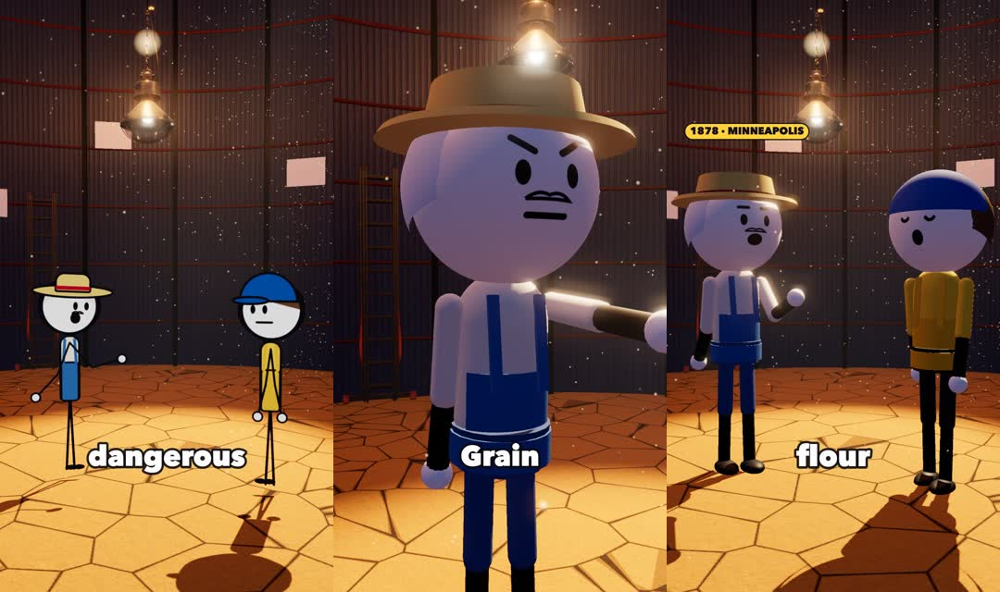
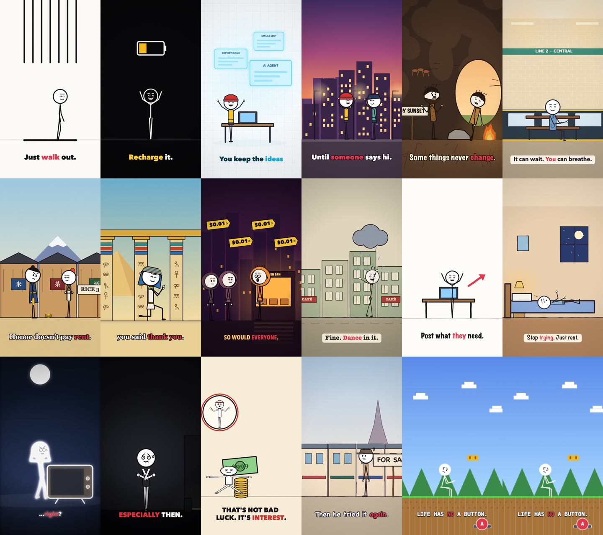

# stickman-shorts

Short vertical history videos with flat round-head characters standing in stylized 3D worlds, made with three.js in the browser and rendered to mp4 frame by frame. No video editor, no After Effects: a story file, a voiceover and one command.


## Watch the examples

Every video below was made by this repo, start to finish, from the story files in `stories/`.

| set | look | short |
|---|---|---|
| `hangar` | WWII hangar, sunny airfield, bomber, bullet-hole board | [The Bullet Holes That Fooled an Army](https://youtube.com/shorts/DrN5xv5VyVc) |
| `goldrush` | 1849 boomtown at golden hour, dust in the air | [He Got Rich From the Gold Rush Without Digging](https://youtube.com/shorts/3HRw8G3LxJA) |
| `city` | blue-hour avenue, lit towers, a steel frame going up | [The Skyscraper Built in Just 410 Days](https://youtube.com/shorts/nwoKeM-Ed9A) |
| `piazza` | Italian square in a storm, bell tower, rain, lightning | [They Rang Church Bells to Stop Lightning](https://youtube.com/shorts/zwi8hEw3dy0) |
| `snow` | winter night, lanterns, an alchemist's table, fireworks | [Fireworks Started as a Search for Immortality](https://youtube.com/shorts/lk3Lqr38JEM) |
| `silo` | farm at sunset, grain silos, a dust explosion | [Why a Silo Full of Corn Can Explode](https://youtube.com/shorts/ZNJsdTR8ykU) |

## Quick start

```sh
git clone https://github.com/justbiar/stickman-shorts && cd stickman-shorts
pip install mlx-whisper                       # word timings (Apple Silicon)
mkdir voice && cp ~/my-voiceover.mp3 voice/hangar.mp3
tools/make.sh hangar                          # -> out/hangar.mp4
```

`make.sh` starts a small local web server, gets the word timings, renders the frames in headless Chrome and mixes the sound. Add a music file and a folder of sound effects as the second and third arguments if you want them.

## How a short is made

```
script ──> voiceover (any TTS or your own mic) ──> word timings (Whisper)
                                                        │
stories/<name>.json  (set, camera shots, acting, labels, fx, all anchored to words)
                                                        │
web/player.html ── headless Chrome renders 30 fps ──> work/<name>.silent.mp4
                                                        │
tools/mix.py  (voice + ducked music + whooshes/booms, -14 LUFS) ──> out/<name>.mp4
```

1. **Write a script.** 20 to 30 seconds, one surprising fact, short sentences. Put it in the story file's `script` field so it lives next to the shots.
2. **Record the voice** to `voice/<name>.mp3`. The examples used a storytelling voice from ElevenLabs; anything works.
3. **Get word timings.** `python tools/words.py voice/<name>.mp3 work/<name>.words.json`, plus `Wrong=Right` pairs to fix names Whisper mishears (`Brannon=Brannan`).
4. **Direct it** in `stories/<name>.json` (below). Preview any moment in a browser at `http://127.0.0.1:8799/web/player.html?story=<name>&t=7.5`.
5. **Build:** `tools/make.sh <name> [music.mp3] [sfx-folder]`.

## The story file

```json
{
 "title": "The bullet holes that fooled an army",
 "style": "hangar",
 "script": "In 1943, the military studied bombers ...",
 "beats": [
  {"at": 0,         "cam": "insert", "on": "plane", "push": 0.6, "label": {"text": "1943", "on": "plane"}},
  {"at": "studied", "cam": "medium", "on": ["officer", "pilot"], "do": {"pilot": "talk excited left"}},
  {"at": "put",     "cam": "insert", "on": "board", "fx": "board2"},
  {"at": "then",    "cam": "wide",   "on": ["wald", "officer"], "show": ["wald"]}
 ]
}
```

Each beat is a hard cut that lasts until the next one.

- `at`: seconds, a spoken word (`"holes"`), or the nth time it is said (`"holes#3"`). Anchoring to words keeps the picture in sync even after you re-record the voice.
- `cam`: `wide`, `medium`, `close`, `low`, `high` on a character (or a list of them, framed together), or `insert` on a named spot of the set.
- `on`: character id(s) or spot name. Each set lists its cast and spots at the bottom of its function in `web/sets.js`.
- `push` (slow dolly in, 0 to 1), `orbit` (radians around the subject), `rise` (crane up).
- `do`: `{"id": "action face look"}`. Use `-` to keep one part as it was.
  - actions: idle, walk, wave, point, talk, shrug, think, jump, cheer, sad, stir, present, hold
  - faces: neutral, happy, excited, surprised, sad, angry, smug, thinking, smirk, determined, shocked
  - look: front, left, right
- `show` / `hide`: bring a character in or take them out. `pos: {"id": [x, z]}` moves one.
- `label`: a pill that pops over a spot or a character: `text`, `on`, `dy` (height offset), `for` (seconds), `bg`, `fg`.
- `fx`: `flash`, `boom` (orange flash and camera shake), `shake`, plus the set's own: `board2` (hangar), `ring` and `lightning` (piazza), `firework` and `boom` (snow), `boom` (silo).

Captions are automatic: one word at a time from the timings, numbers in yellow.

## Characters

`web/character.js` draws every character on a 2D canvas each frame; the canvas is the texture of a plane that turns to face the camera, so they read as flat drawings standing in a lit 3D world and still cast shadows. Costume keys:

```
shirt, pants, skin
outfit: coat | suit | vest | hivis | overalls     (+ coat, tie, vest, overalls colors)
scarf, beard: mustache | full | stubble, beardColor, glasses
hat: fedora | cowboy | hardhat | helmet | pilot | beanie | straw | cap   (+ hatColor, hatBand)
```

## Making a new world

Add a function to `SETS` in `web/sets.js`. It gets a toolkit `k` (`box`, `cyl`, `ground`, `sky`, `glow`, `tex`, `particles`, `light`, `character`, `spot` and more) and returns `{ fx(t, events) }` for anything that moves. Keep shapes simple and let the lighting do the work: a three-color sky gradient, fog in the same color family as the horizon, one strong sun for shadows, a few additive glows for lamps.

## Realistic worlds: real models, photo textures, 3D characters



The `siloIn` world is the step up from primitive shapes: it is built from CC0 Poly Haven assets in `web/assets/` (corrugated steel, grain and plank photo textures; glTF lamps, ladder, barrels and a crate), loaded with the player's `k.model()` and `k.photo()` helpers. A cracked grain crust is painted once into a canvas with Voronoi cells, a cone with a soft additive shader fakes the daylight beam from a high hatch, and dust drifts through it. A dust explosion fires on `"fx": "boom"`.

Characters come in two looks, picked per story:

- flat cards (default): the 2D round-head figures standing in the 3D world
- `"chars3d": true`: real 3D figures from `web/char3d.js`, a lit sphere head with a painted face decal, clothed torso, tube limbs with joints, gloves, shoes and hats. They take the same actions and expressions as the 2D kit, so a story switches look with one line.

| short | story file |
|---|---|
| Why a silo full of corn can explode, flat cards | `stories/silo-in.json` |
| the same with 3D characters | `stories/silo-in-3d.json` |

Both render in about 30 seconds for 24 seconds of video. A new short in an existing world is only a new story file; a new world is written once in `sets.js`.

An earlier test built the same silo in Blender from Python (Cycles-style lighting, about 8 seconds per frame). It looked a little richer but was roughly 500 times slower, so the project stays on three.js.

## The stick library (2D)

Next to the three.js worlds there is a flat 2D kit in `web/kit/`, made for quick silent shorts in 17 looks. Everything is drawn in code, frame by frame: no image generation, no voice credits.



| file | what is in it |
|---|---|
| `kit/figure.js` | one parametric stick figure, five bodies (`line`, `torso`, `rubber`, `glow`, `chunky`) and costumes: hoodie, suit, kimono, fur, Egyptian kilt, robe, dress, apron, hats, hair, beards, glasses, gloves |
| `kit/face.js` | 31 expressions, each with exactly one mouth ([sheet](docs/library/faces.png)) |
| `kit/poses.js` | 66 actions: talking, pointing, walking, running, sneaking, sitting, kneeling, lying down, falling, fighting, being dragged and more ([sheet](docs/library/poses.png)) |
| `kit/props.js` | 37 props: cage, battery, phone, speech and thought bubbles, coins, bills, price tags, TV, clock, fire, rain cloud, cat, glass UI panels and more ([sheet](docs/library/props.png)) |
| `kit/backgrounds.js` | 15 painted worlds: paper, black, tech grid, city at dusk, cave, subway, Edo street, Egyptian temple, amber noir, vintage street, bedroom, dark TV void, dark room, Paris, pixel world |
| `kit/styles.js` | the 17 presets: pen (clean or hand-drawn with line boil), default figure, background, caption type, finishing passes (grain, vignette, scanlines, bloom, pixelation) ([sheet](docs/library/bodies.png)) |

| style | look |
|---|---|
| `a1-light`, `a1-dark` | classic black ink on white, or white on black |
| `a2-tech`, `a2-story` | red beanie, yellow shirt; glass UI on a grid, or a colorful city |
| `a3-cave` | prehistoric, rough boiling lines, campfire |
| `a4-cozy` | soft everyday places, warm light |
| `a5-edo`, `a5-egypt` | historical cartoon, white round heads, period costumes |
| `a6-amber` | orange hood, golden light, plum shadows |
| `a7-rubber` | thin noodle limbs, gloves, two hair tufts, sepia grain |
| `b1-line`, `b2-hand` | minimal line art on paper, or colorful hand-drawn with paper captions |
| `b3-retrotv` | glowing figures, scanlines, bloom |
| `b4-survival` | chunky figure with white gloves, dark room, flashlight vignette |
| `b5-avatar` | presenter in a corner badge, stickman acting out the idea |
| `b6-meme` | loose lines, soft colors, wide comedy staging |
| `b7-pixel` | the whole frame rendered at 1/6 resolution and scaled up crisp |

A 2D clip is a JSON file in `clips/`: a cast, props, and beats on a timeline (seconds), each able to change acting (`do`), move things (`move`), show or hide props, animate a prop value (`anim`, like a battery draining), move the camera (`cam`), set the caption (`*word*` is highlighted) and fire `shake`, `flash`, `boom` or `punch`.

```sh
node tools/render.mjs "http://127.0.0.1:8799/web/clip.html?clip=a1-light" out/a1-light.mp4 30
```

Contact sheets of the whole kit: `web/library.html?sheet=faces|poses|bodies|props`.

The style catalogue was inspired by [kaomei/stickman-video-director](https://github.com/kaomei/stickman-video-director) (MIT), which builds these looks with image models. Here each look is rebuilt from scratch in canvas code.

## Requirements

- Node 22 or newer (uses the built-in WebSocket, no npm install)
- Google Chrome (set `CHROME=/path/to/chrome` if it is not in the default macOS location)
- ffmpeg
- Python 3 with `mlx-whisper` for timings (Apple Silicon). On other machines, swap `tools/words.py` for any Whisper build that gives word timestamps in the same `[{"w", "s", "e"}]` format.

## Rendering speed

Around 30 frames a second on an M-series Mac, so a 25 second short renders in under a minute.

## Credits

three.js (MIT) is vendored in `web/`. Textures and models in `web/assets/` are CC0 from [Poly Haven](https://polyhaven.com) (corrugated_iron_02, dense_sand, brown_planks_05, hanging_industrial_lamp, ladder_sectioned_01, barrel_03, old_military_crate). Music and sound effects are not included; bring your own (CC0 libraries such as Freesound work well).

MIT licensed.
